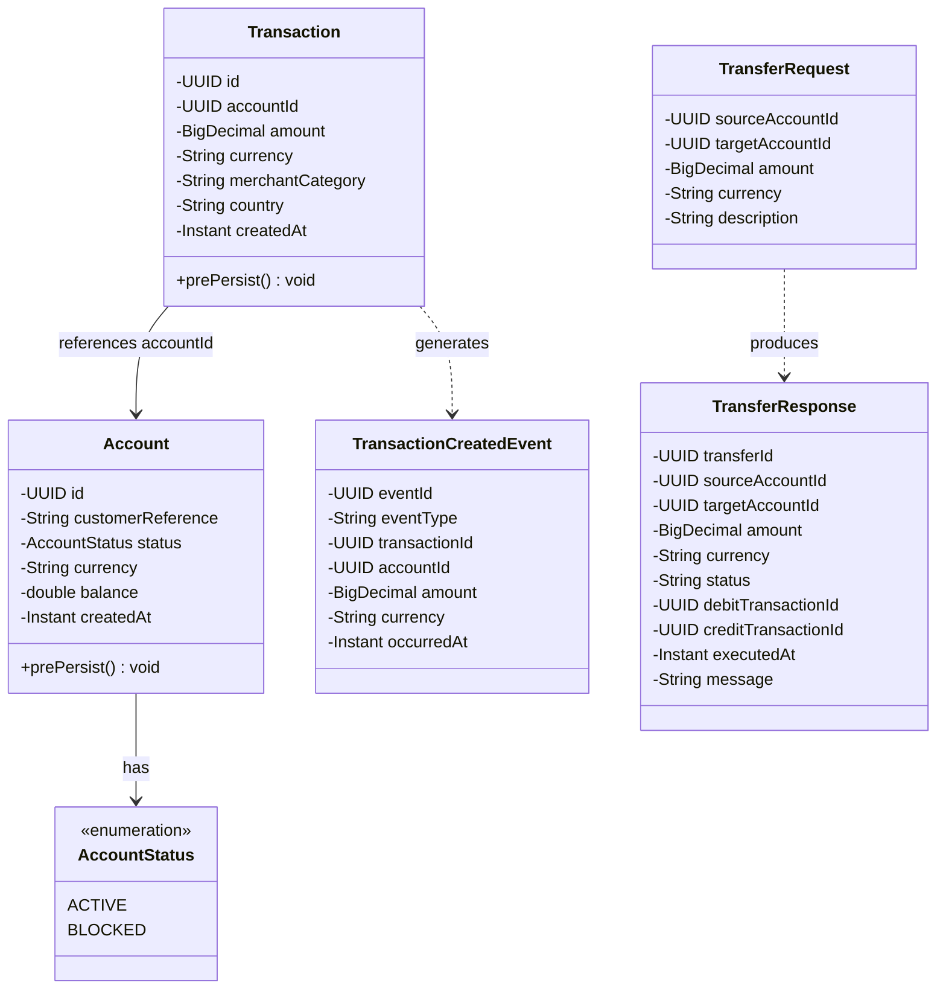
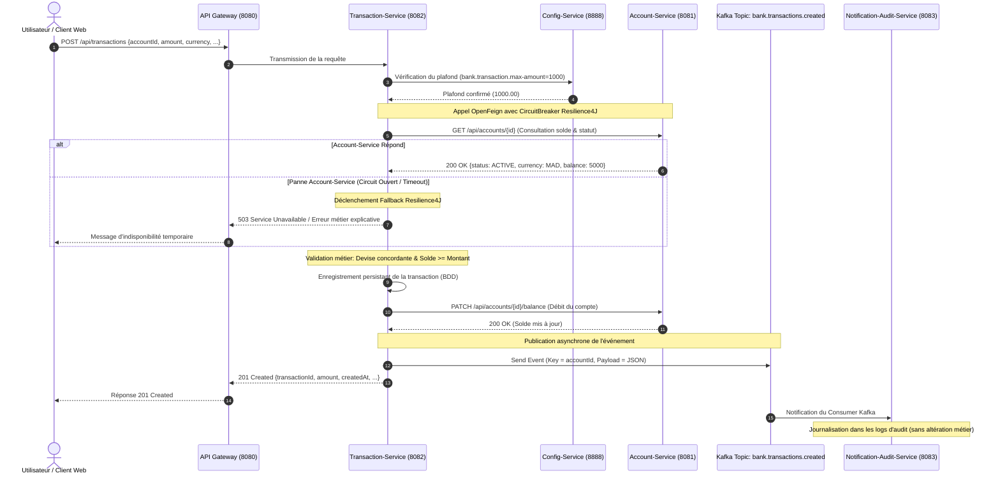

# Architecture du Système & Conception — ADRIA Bank Platform

> Ce document décrit l'architecture distribuée en microservices, les patrons de conception, la tolérance aux pannes, les flux asynchrones Kafka et les diagrammes de conception (Architecture et Classes) de la plateforme **ADRIA Bank**.

---

## 1. Vue d'ensemble du Système (High-Level Design)

La plateforme bancaire repose sur une architecture distribuée moderne construite avec **Spring Boot 3**, **Spring Cloud (Gateway, Eureka Discovery, Config Server)**, **OpenFeign & Resilience4J**, **Apache Kafka** pour l'événementiel, **Spring GraphQL**, un protocole **MCP (Model Context Protocol)** pour l'intégration d'agents IA, et un client web réactif développé avec **React + Tailwind CSS** (Clean Light UI).

```mermaid
flowchart TD
    subgraph Clients["Clients & Canaux d'Accès"]
        Web["Client Web React (Clean Light UI)"]
        Chat["Assistant IA Conversationnel (MCP / REST)"]
        Telegram["Client Telegram / Discord"]
    end

    subgraph Edge["Couche d'Accès & Routage"]
        Gateway["Spring Cloud Gateway (Port 8080)<br/>CORS / Routage / Sécurité"]
    end

    subgraph DiscoveryConfig["Composants Techniques & Découverte"]
        Eureka["Eureka Discovery Service (Port 8761)"]
        Config["Spring Cloud Config Server (Port 8888)<br/>bank.transaction.max-amount=1000"]
    end

    subgraph Microservices["Microservices Métier"]
        AccountSvc["Account-Service (Port 8081)<br/>• REST / GraphQL / MCP<br/>• Gestion Comptes Bancaires"]
        TxSvc["Transaction-Service (Port 8082)<br/>• REST / GraphQL / MCP<br/>• OpenFeign + Resilience4J<br/>• Règles Métier & Virements"]
    end

    subgraph MessagingAudit["Événementiel & Audit Asynchrone"]
        KafkaBrokers{{"Cluster Kafka<br/>Topic: bank.transactions.created"}}
        AuditSvc["Notification-Audit-Service (Port 8083)<br/>Consumer & Journalisation Événements"]
    end

    subgraph IntelligenceLayer["Assistant Agentic"]
        AiSvc["Agentic-Chatbot-Service (Port 8084)<br/>Orchestrateur d'Outils MCP"]
    end

    Web -->|HTTP / JSON| Gateway
    Chat -->|REST / Chat API| Gateway
    Telegram -->|Webhook| Gateway

    Gateway --> AccountSvc
    Gateway --> TxSvc
    Gateway --> AuditSvc
    Gateway --> AiSvc

    AccountSvc -.->|Enregistrement| Eureka
    TxSvc -.->|Enregistrement| Eureka
    AuditSvc -.->|Enregistrement| Eureka
    AiSvc -.->|Enregistrement| Eureka

    TxSvc -->|Lecture Config| Config

    TxSvc -->|OpenFeign + Circuit Breaker| AccountSvc
    TxSvc -->|Publish Event (Key: accountId)| KafkaBrokers
    KafkaBrokers -->|Subscribe & Log| AuditSvc

    AiSvc -->|MCP Protocol /tools/call| AccountSvc
    AiSvc -->|MCP Protocol /tools/call| TxSvc
```

---

## 2. Diagramme de Classes Métier (Partie B)

Conformément à la Partie B du cahier des charges, voici le diagramme de classes complet illustrant les modèles métier, les énumérations, et les relations :



---

## 3. Matrice des Composants & Modules

| Module Maven | Port | Technologies Clés | Responsabilités & Périmètre |
| :--- | :--- | :--- | :--- |
| **`discovery-service`** | `8761` | Spring Cloud Netflix Eureka Server | Registre dynamique des instances de microservices et résilience d'adressage. |
| **`config-service`** | `8888` | Spring Cloud Config Server (Native) | Centralisation des paramètres partagés (dont `bank.transaction.max-amount=1000`). |
| **`gateway-service`** | `8080` | Spring Cloud Gateway, WebFlux | Point d'entrée unique, filtre CORS, réécriture de chemins REST, GraphQL et MCP. |
| **`account-service`** | `8081` | Spring Data JPA, H2, Spring GraphQL, MCP | Gestion du cycle de vie des comptes, statut (`ACTIVE`, `BLOCKED`), débits/crédits. |
| **`transaction-service`** | `8082` | OpenFeign, Resilience4J, Kafka Producer | Exécution des transactions, contrôle plafond/devise/solde, virements et publication Kafka. |
| **`notification-audit-service`** | `8083` | Spring Kafka Consumer | Consommation du topic `bank.transactions.created` et traçabilité sans altération métier. |
| **`agentic-chatbot-service`** | `8084` | MCP Client, AI Agent Engine, Webhooks | Assistant IA conversationnel connecté aux outils MCP des microservices bancaires. |
| **`frontend-client`** | `5173` | React 18, Vite, Tailwind CSS, Lucide | Interface utilisateur moderne Bento Grid, modales contextuelles et drawer IA. |

---

## 4. Flux Séquentiel d'une Transaction Bancaire & Tolérance aux Pannes

Le diagramme de séquence ci-dessous détaille le cheminement d'une requête de transaction avec vérification OpenFeign, protection Resilience4J et publication d'événement Kafka :



---

## 5. Architecture en Couches (Clean Layering)

Conformément à la consigne stricte du sujet :
> *« Séparation des couches : domain/, repository/, service/, web/rest/, web/graphql/, mcp/ — Les contrôleurs REST, GraphQL et MCP doivent appeler la même couche service. »*

Les microservices `account-service` et `transaction-service` respectent scrupuleusement ce découpage :
1. **`domain/`** : Entités JPA (`Account`, `Transaction`), énumérations et DTOs de transfert.
2. **`repository/`** : Interfaces Spring Data JPA pour la persistance.
3. **`service/`** : Cœur métier encapsulant les règles (validation de montants, conformité de devises, vérification des statuts et mises à jour de soldes).
4. **`web/rest/`** : Contrôleurs REST fournissant des endpoints HTTP CRUD et opérationnels.
5. **`web/graphql/`** : Schémas et contrôleurs GraphQL (`@QueryMapping`, `@MutationMapping`) appelant la même couche service.
6. **`mcp/`** : Contrôleurs MCP exposant la découverte d'outils (`/mcp/tools`) et leur exécution (`/mcp/tools/call`) pour les agents conversationnels.

---
[Retour au README principal](../README.md)

