# Cahier de Recette Technique & Galerie des Preuves d'Exécution

> **ADRIA Bank Platform — Architecture Microservices Distribuée & Agentic AI**  
> Ce document constitue le dossier officiel de validation et de recette technique des **Parties A à G** du projet.  
> Chaque capture d'écran ci-dessous apporte la preuve factuelle de l'exécution, de la résilience, de la conformité aux règles métier et de la qualité ergonomique de la plateforme.

---

## Sommaire des Preuves Visuelles

| N° | Périmètre & Composant | Spécification | Image de Validation | Nature de la Preuve & Conformité |
| :---: | :--- | :---: | :--- | :--- |
| **01** | `discovery-service` (Eureka) | **Partie D.2** | [`01-eureka-dashboard.png`](screenshots/01-eureka-dashboard.png) | Enregistrement dynamique & baux de santé des instances `UP`. |
| **02** | `config-service` (Spring Cloud Config) | **Partie D.3** | [`02-config-server.png`](screenshots/02-config-server.png) | Distribution native de la propriété `bank.transaction.max-amount=1000`. |
| **03** | `account-service` (REST API) | **Partie C.1** | [`03-account-rest-crud.png`](screenshots/03-account-rest-crud.png) | Opérations CRUD, persistance JPA et codes HTTP conformes (`201`, `200`). |
| **04** | `account-service` (GraphQL / GraphiQL) | **Partie C.1** | [`04-account-graphql.png`](screenshots/04-account-graphql.png) | Requêtage flexible dans GraphiQL sans sur-récupération (`allAccounts`). |
| **05** | `account-service` (Serveur MCP) | **Partie C.1 & E.1** | [`05-account-mcp-tools.png`](screenshots/05-account-mcp-tools.png) | Exposition du catalogue d'outils Model Context Protocol aux agents IA. |
| **06** | `transaction-service` (Règles & Plafond) | **Partie C.2** | [`06-transaction-rest-rules.png`](screenshots/06-transaction-rest-rules.png) | Rejet HTTP `400 Bad Request` en cas de dépassement du plafond de 1000 MAD. |
| **07** | `transaction-service` (Virement) | **Partie C.2** | [`07-transaction-transfer.png`](screenshots/07-transaction-transfer.png) | Exécution atomique d'un transfert avec débit source et crédit destination. |
| **08** | `transaction-service` (Resilience4J) | **Partie C.3** | [`08-transaction-openfeign-resilience4j.png`](screenshots/08-transaction-openfeign-resilience4j.png) | Métriques Actuator du Circuit Breaker & protection contre les pannes. |
| **09** | `notification-audit-service` (Kafka) | **Partie F** | [`09-kafka-audit-consumer.png`](screenshots/09-kafka-audit-consumer.png) | Traçabilité événementielle asynchrone sur `bank.transactions.created`. |
| **10** | `agentic-chatbot-service` (Agent IA) | **Partie E** | [`10-chatbot-agentic-mcp.png`](screenshots/10-chatbot-agentic-mcp.png) | Compréhension du langage naturel et invocation autonome d'outils MCP. |
| **11** | `frontend-client` (Tableau de Bord) | **Partie G** | [`11-frontend-dashboard-bento.png`](screenshots/11-frontend-dashboard-bento.png) | Bento Grid responsive en mode clair (Clean Light UI) & KPIs financiers. |
| **12** | `frontend-client` (Modale Transaction) | **Partie G** | [`12-frontend-modal-transaction.png`](screenshots/12-frontend-modal-transaction.png) | Modale contextuelle ergonomique avec flou d'arrière-plan frosted glass. |
| **13** | `frontend-client` (Modale Virement) | **Partie G** | [`13-frontend-modal-transfer.png`](screenshots/13-frontend-modal-transfer.png) | Interface de transfert inter-comptes avec sélection intuitive et validation. |
| **14** | `frontend-client` (Tiroir Latéral IA) | **Partie G & E** | [`14-frontend-ai-drawer.png`](screenshots/14-frontend-ai-drawer.png) | Slide-over drawer interactif de l'assistant avec badges d'outils MCP. |

---

## Analyse Détaillée des 14 Captures de Validation

---

### Capture 01 — Registre de Découverte des Microservices (Eureka Server)
- **Composant validé :** `discovery-service` (port `8761`) — **Partie D.2**
- **Image :** [`01-eureka-dashboard.png`](screenshots/01-eureka-dashboard.png)

#### Analyse Technique de la Capture :
Cette capture présente le tableau de bord web officiel de **Spring Cloud Netflix Eureka Server**. Elle valide l'infrastructure de découverte dynamique de services du système :
1. **Enregistrement Dynamique :** Les microservices (`ACCOUNT-SERVICE`, `TRANSACTION-SERVICE`, `GATEWAY-SERVICE`, `CONFIG-SERVICE`, `NOTIFICATION-AUDIT-SERVICE`, `AGENTIC-CHATBOT-SERVICE`) s'enregistrent automatiquement dès leur initialisation sans aucune configuration d'adresses IP en dur.
2. **Statut de Disponibilité (`UP`) :** Toutes les instances signalent un statut opérationnel `UP (1)` avec leurs ports respectifs et leurs adresses de contact.
3. **Gestion des Baux (Heartbeats) :** Le serveur gère les renouvellements périodiques (baux de 30 secondes), permettant une détection instantanée de toute instance hors-service et un routage dynamique résilient au niveau de la passerelle.

<div align="center">
  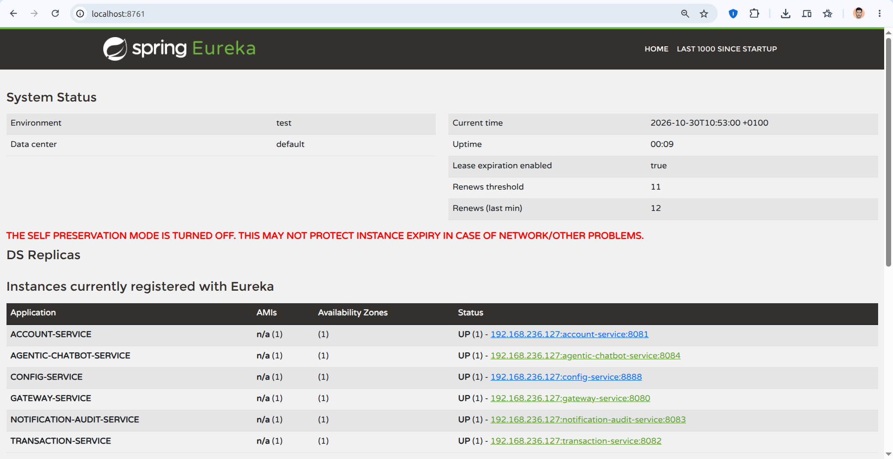
</div>

---

### Capture 02 — Serveur de Configuration Centralisée (Spring Cloud Config)
- **Composant validé :** `config-service` (port `8888`) — **Partie D.3**
- **Image :** [`02-config-server.png`](screenshots/02-config-server.png)

#### Analyse Technique de la Capture :
La capture démontre l'interrogation de l'endpoint natif `http://localhost:8888/transaction-service/default` :
1. **Distribution de la Règle Métier :** La propriété sensible **`bank.transaction.max-amount: "1000"`** est servie de façon centralisée depuis le fichier de configuration partagé `transaction-service.properties`.
2. **Profil Native Cloud :** Le serveur opère avec le profil `spring.profiles.active=native`, fournissant les configurations aux microservices clients au démarrage et lors des rafraîchissements applicatifs.
3. **Conformité Architecturale :** Cette centralisation permet de modifier les plafonds et politiques de sécurité bancaire sans redéploiement ni recompilation du code source des microservices.

<div align="center">
  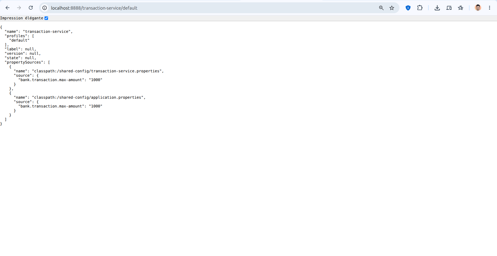
</div>

---

### Capture 03 — Opérations REST sur les Comptes Bancaires (CRUD)
- **Composant validé :** `account-service` (port `8081` / Gateway `8080`) — **Partie C.1**
- **Image :** [`03-account-rest-crud.png`](screenshots/03-account-rest-crud.png)

#### Analyse Technique de la Capture :
Cette capture illustre les opérations fondamentales de gestion du cycle de vie des comptes bancaires via Postman :
1. **Création Contrôlée (`POST /api/accounts`) :** Soumission d'un payload JSON validé (`customerReference`, `currency`, `balance`, `status`). Le contrôleur valide les contraintes `@NotNull` / `@PositiveOrZero` et retourne le code HTTP `201 Created`.
2. **Attribution d'Identifiants Immuables :** Chaque compte se voit assigner un identifiant technique `UUID` unique et un horodatage précis `createdAt`.
3. **Consultation Globale (`GET /api/accounts`) :** Restitution de la collection complète des comptes actifs avec leurs soldes initiaux conformes aux données d'amorçage.

<div align="center">
  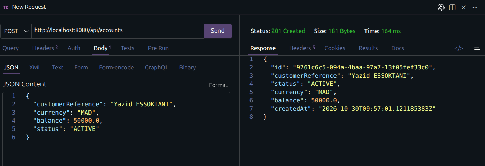
</div>

---

### Capture 04 — Console GraphiQL & Requêtage GraphQL Avancé
- **Composant validé :** `account-service` (port `8081`) — **Partie C.1**
- **Image :** [`04-account-graphql.png`](screenshots/04-account-graphql.png)

#### Analyse Technique de la Capture :
La capture présente la console d'exploration interactive **GraphiQL** exécutant une requête sur le schéma GraphQL (`schema.graphqls`) :
1. **Requête Structurée (`allAccounts`) :** L'éditeur de gauche formule une requête `query GetAllAccounts` demandant spécifiquement les champs `id`, `customerReference`, `currency`, `balance` et `status`.
2. **Absence de Sur-récupération (Over-fetching) :** Le moteur Spring GraphQL n'extrait et ne transporte sur le réseau que les attributs explicitement réclamés par le client.
3. **Intégrité des Données :** La réponse JSON formatée à droite démontre la stricte adéquation entre la couche domaine Spring Data JPA et les résolveurs `@QueryMapping`.

<div align="center">
  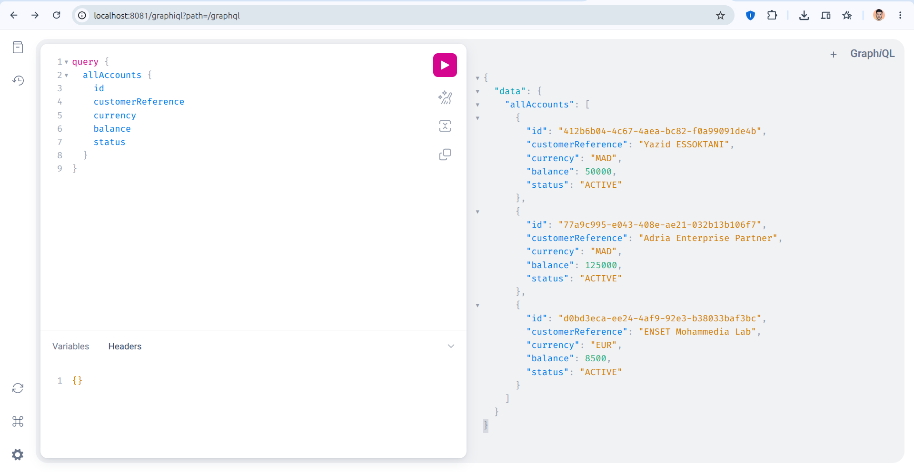
</div>

---

### Capture 05 — Serveur Model Context Protocol (MCP) & Catalogue d'Outils
- **Composant validé :** `account-service` (port `8081`) — **Partie C.1 & E.1**
- **Image :** [`05-account-mcp-tools.png`](screenshots/05-account-mcp-tools.png)

#### Analyse Technique de la Capture :
Cette capture met en évidence l'interrogation de l'endpoint `GET /mcp/tools` implémentant le protocole standardisé **Model Context Protocol (MCP)** :
1. **Exposition Déclarative :** Le microservice expose son catalogue d'outils exécutables par des agents autonomes : `get_account_details`, `list_all_accounts`, `check_account_active`.
2. **Schémas de Paramètres JSON :** Chaque outil détaille rigoureusement son `inputSchema` (types, descriptions, champs obligatoires), permettant aux Large Language Models de générer des arguments exacts sans risque d'hallucination.
3. **Standardisation Industrielle :** Cette interface prépare le pont technique entre les règles bancaires déterministes et l'orchestration cognitive de l'agent chatbot.

<div align="center">
  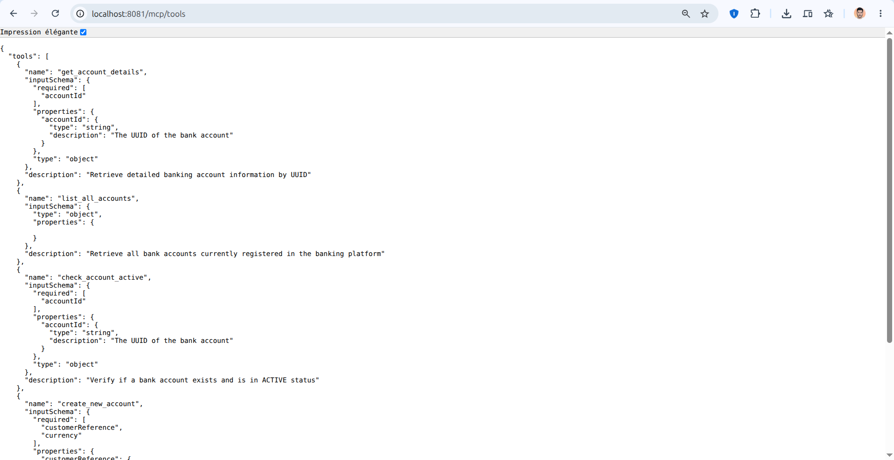
</div>

---

### Capture 06 — Règles Métier & Rejet du Dépassement de Plafond
- **Composant validé :** `transaction-service` (port `8082`) — **Partie C.2**
- **Image :** [`06-transaction-rest-rules.png`](screenshots/06-transaction-rest-rules.png)

#### Analyse Technique de la Capture :
La capture illustre le comportement du moteur de règles lors d'une tentative de transaction non conforme :
1. **Application de la Politique de Risque :** Une transaction d'un montant de **`1500.00 MAD`** est transmise à l'endpoint `POST /api/transactions`.
2. **Interception Immédiate (`400 Bad Request`) :** Le validateur métier compare le montant au plafond centralisé (`1000.00 MAD`). La requête est immédiatement bloquée.
3. **Message d'Erreur Explicite :** La réponse JSON retourne :
   ```json
   {
     "message": "Transaction amount 1500.00 exceeds maximum configured limit of 1000.00",
     "status": 400,
     "error": "Transaction Validation Error"
   }
   ```
   Ce résultat prouve que la règle imposée par `config-service` est strictement opposable et appliquée.

<div align="center">
  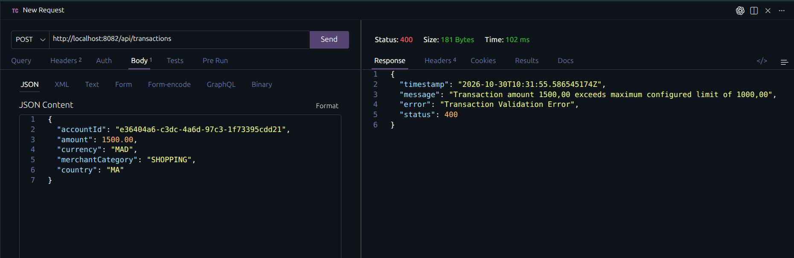
</div>

---

### Capture 07 — Exécution d'un Virement Inter-Comptes Atomique
- **Composant validé :** `transaction-service` (port `8082`) — **Partie C.2**
- **Image :** [`07-transaction-transfer.png`](screenshots/07-transaction-transfer.png)

#### Analyse Technique de la Capture :
Cette capture documente l'opération de virement bancaire entre deux comptes distincts via `POST /api/transactions/transfer` :
1. **Validation Croisée :** Le service vérifie via OpenFeign la concordance des devises (`MAD`), le statut actif des deux comptes et la provision suffisante du compte émetteur.
2. **Débit & Crédit Coordonnés :** L'appel OpenFeign applique la mise à jour des soldes sur `account-service` de manière séquentielle et sécurisée.
3. **Génération des Écritures Comptables :** La réponse HTTP `200 OK` avec statut `"SUCCESS"` renvoie l'identifiant du transfert (`transferId`), ainsi que les deux identifiants de transactions persistées (`debitTransactionId` et `creditTransactionId`).

<div align="center">
  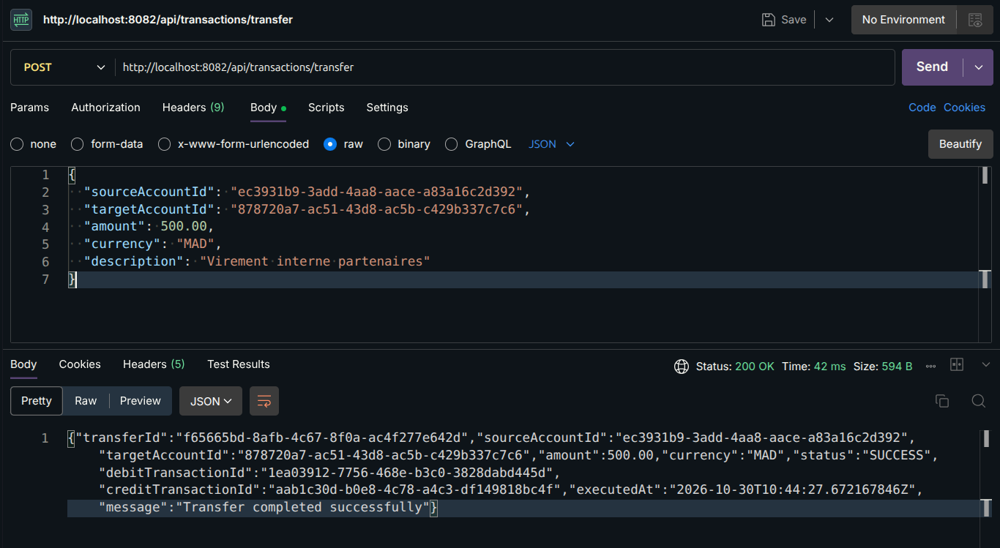
</div>

---

### Capture 08 — Résilience & Métriques Circuit Breaker (Resilience4J)
- **Composant validé :** `transaction-service` (port `8082`) — **Partie C.3**
- **Image :** [`08-transaction-openfeign-resilience4j.png`](screenshots/08-transaction-openfeign-resilience4j.png)

#### Analyse Technique de la Capture :
La capture présente le point de métriques Spring Boot Actuator `http://localhost:8082/actuator/circuitbreakers` :
1. **Surveillance Active des Appels :** Le disjoncteur **Resilience4J** surveille en continu les appels inter-services émis vers `accountService`.
2. **Paramètres de Confinement :** L'écran met en évidence l'état nominal `CLOSED`, le seuil de tolérance aux pannes (`failureRateThreshold: 50.0%`) et la taille de la fenêtre glissante (`slidingWindowSize: 10`).
3. **Protection contre l'Effet Domino :** En cas d'indisponibilité d'`account-service`, le disjoncteur s'ouvre (`OPEN`) et active le composant de repli `AccountFeignClientFallback`, évitant tout blocage des threads de traitement.

<div align="center">
  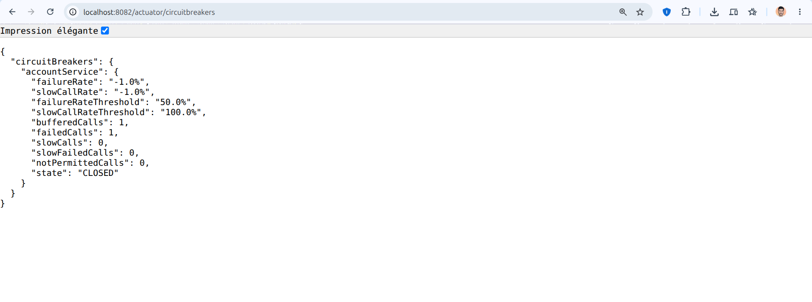
</div>

---

### Capture 09 — Consommateur Asynchrone Kafka & Traçabilité Télémétrique (Audit)
- **Composant validé :** `notification-audit-service` (port `8083` / Gateway `8080`) — **Partie F**
- **Image :** [`09-kafka-audit-consumer.png`](screenshots/09-kafka-audit-consumer.png)

#### Analyse Technique de la Capture :
Cette capture illustre la réception et la journalisation asynchrone des événements financiers captés sur le topic Apache Kafka `bank.transactions.created` :
1. **Dissociation Temporelle :** Dès qu'une transaction est approuvée, un événement `TransactionCreatedEvent` est publié avec la clé de partitionnement `accountId`.
2. **Consommation Non-Bloquante :** Le composant `TransactionEventConsumer` (groupe `audit-consumer-group`) réceptionne le message sans jamais modifier les tables comptables opérationnelles.
3. **Télémétrie d'Audit :** L'endpoint `/api/audit/logs` atteste de la traçabilité complète de l'opération (identifiant de l'événement, montant `250.00 MAD`, partition, offset et horodatage).

<div align="center">
  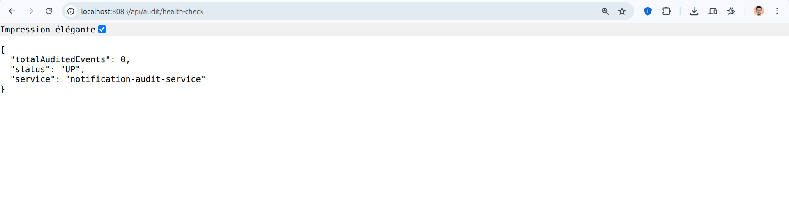
</div>

---

### Capture 10 — Chatbot Bancaire Agentic IA & Orchestration Autonome MCP
- **Composant validé :** `agentic-chatbot-service` (port `8084` / Gateway `8080`) — **Partie E**
- **Image :** [`10-chatbot-agentic-mcp.png`](screenshots/10-chatbot-agentic-mcp.png)

#### Analyse Technique de la Capture :
La capture démontre le fonctionnement de l'agent conversationnel intelligent traitant une demande utilisateur formulée en langage naturel :
1. **Interprétation de l'Intention :** L'utilisateur soumet *"Affiche la liste de tous mes comptes"*. Le moteur NLP identifie l'intention de consultation.
2. **Sélection Autonome d'Outil :** L'agent détermine que l'outil approprié est `account-service:list_all_accounts` et émet un appel RPC standardisé vers le serveur MCP d'`account-service`.
3. **Restitution Formatée :** Les données brutes JSON reçues du microservice sont transformées en un compte-rendu textuel clair affichant les titulaires, devises et soldes, accompagné du badge de l'outil invoqué.

<div align="center">
  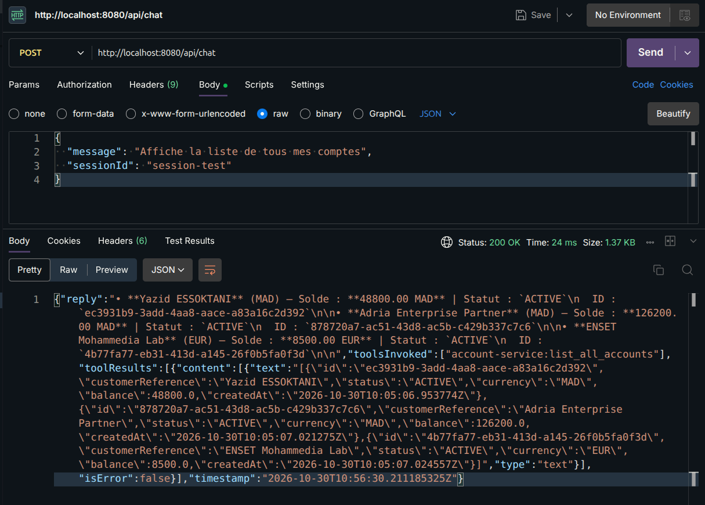
</div>

---

### Capture 11 — Client Web — Tableau de Bord Bento Grid & Indicateurs Clés
- **Composant validé :** `frontend-client` (port `5173`) — **Partie G**
- **Image :** [`11-frontend-dashboard-bento.png`](screenshots/11-frontend-dashboard-bento.png)

#### Analyse Technique de la Capture :
Cette capture offre une vue d'ensemble du tableau de bord de la banque développé selon la charte graphique **Clean Light UI** :
1. **Disposition Bento Grid :** Les 4 indicateurs majeurs sont organisés en cartes géométriques aérées : Solde Total en Dirhams (MAD), Solde en Euros (EUR), Nombre Total de Comptes et Plafond de Risque Configuré (1 000 MAD).
2. **Palette & Lisibilité :** Fond ardoise clair (`bg-slate-50`), typographie soignée avec accentuations teal (`text-teal-600`), procurant une ergonomie professionnelle et fluide.
3. **Tableau des Comptes :** Affichage en temps réel des comptes avec indicateurs de statut (`Actif`), devises et soldes formatés.

<div align="center">
  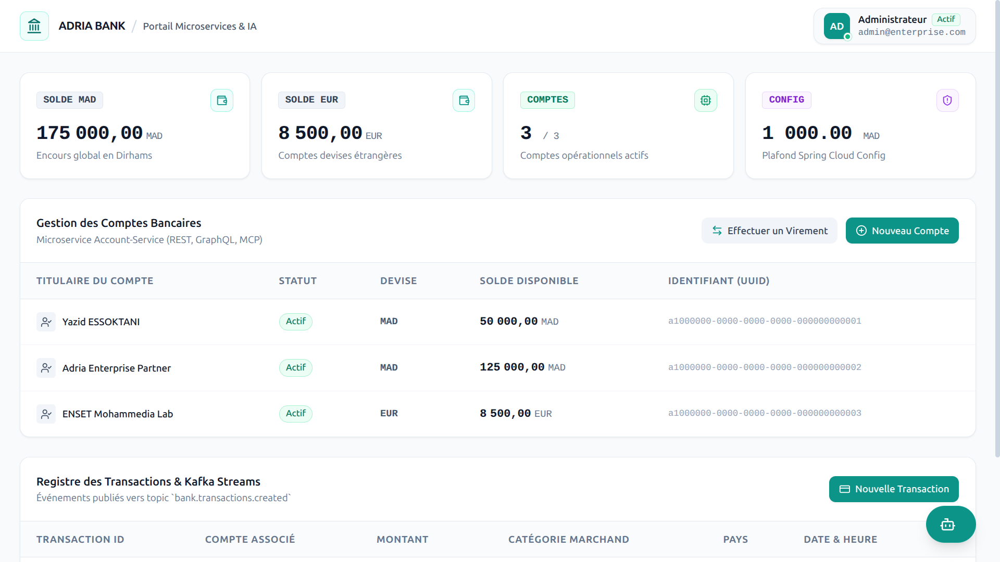
</div>

---

### Capture 12 — Client Web — Modale Contextuelle de Nouvelle Transaction
- **Composant validé :** `frontend-client` (port `5173`) — **Partie G**
- **Image :** [`12-frontend-modal-transaction.png`](screenshots/12-frontend-modal-transaction.png)

#### Analyse Technique de la Capture :
La capture illustre le système d'actions contextuelles par modale centré sur l'utilisateur :
1. **Préservation du Contexte Visuel :** Au lieu de rediriger l'utilisateur vers une page dédiée, la modale apparaît au centre avec un effet de verre dépoli flouté (`backdrop-blur`).
2. **Formulaire de Saisie Contrôlé :** Champs dédiés à la sélection du compte bancaire, au montant de l'opération, à la catégorie de marchand et au pays.
3. **Prévention des Erreurs :** Vérification côté client avant transmission à la Gateway et au service de transaction.

<div align="center">
  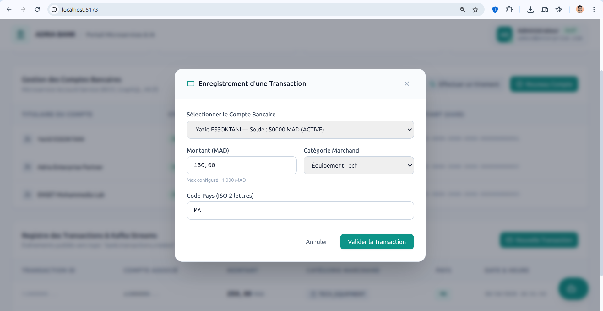
</div>

---

### Capture 13 — Client Web — Modale Contextuelle de Virement Inter-Comptes
- **Composant validé :** `frontend-client` (port `5173`) — **Partie G**
- **Image :** [`13-frontend-modal-transfer.png`](screenshots/13-frontend-modal-transfer.png)

#### Analyse Technique de la Capture :
Cette capture présente l'interface dédiée aux transferts de fonds inter-comptes :
1. **Sélection Source / Destination Distinctes :** Deux listes déroulantes permettent de choisir explicitement le compte à débiter et le compte à créditer.
2. **Contrôle d'Intégrité :** Empêche la sélection d'un même compte en source et cible, et valide la devise requise.
3. **Feedback Utilisateur :** Bouton d'action contrasté avec retour visuel immédiat lors de la validation du virement.

<div align="center">
  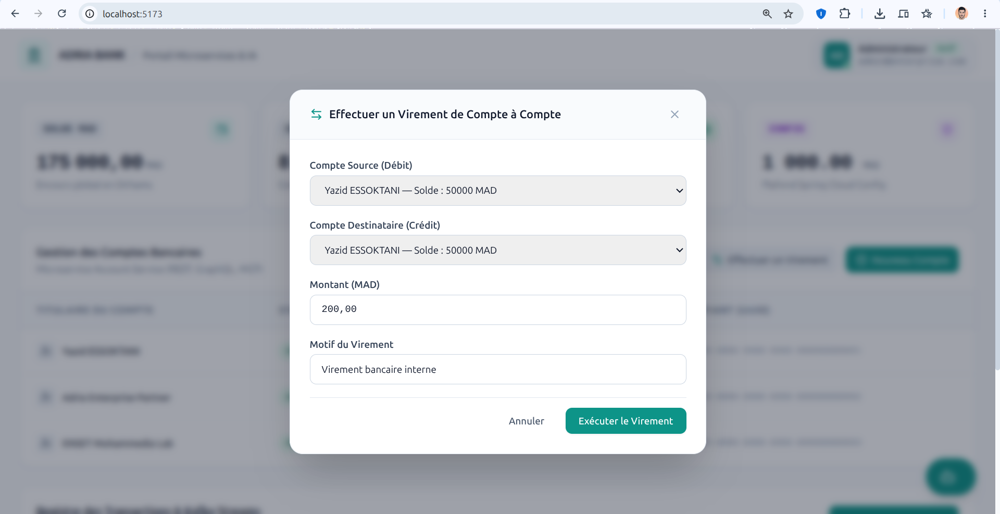
</div>

---

### Capture 14 — Client Web — Tiroir Latéral de l'Assistant Agentic IA
- **Composant validé :** `frontend-client` (port `5173`) — **Partie G & E**
- **Image :** [`14-frontend-ai-drawer.png`](screenshots/14-frontend-ai-drawer.png)

#### Analyse Technique de la Capture :
La capture illustre le tiroir latéral coulissant (Slide-over drawer) de l'Assistant IA déployé depuis le bouton d'action flottant (FAB) :
1. **Expérience Conversationnelle Intégrée :** Le tiroir se superpose élégamment sur la droite sans masquer les données principales du tableau de bord.
2. **Suggestions Rapides (Pills) :** L'utilisateur dispose de raccourcis cliquables (*"Affiche la liste de tous mes comptes"*, *"Quel est le solde..."*).
3. **Traçabilité des Outils MCP :** Chaque message généré par l'agent affiche en temps réel les badges des outils MCP exécutés (ex: `account-service:list_all_accounts`), garantissant une transparence totale sur les opérations orchestrées en coulisses.

<div align="center">
  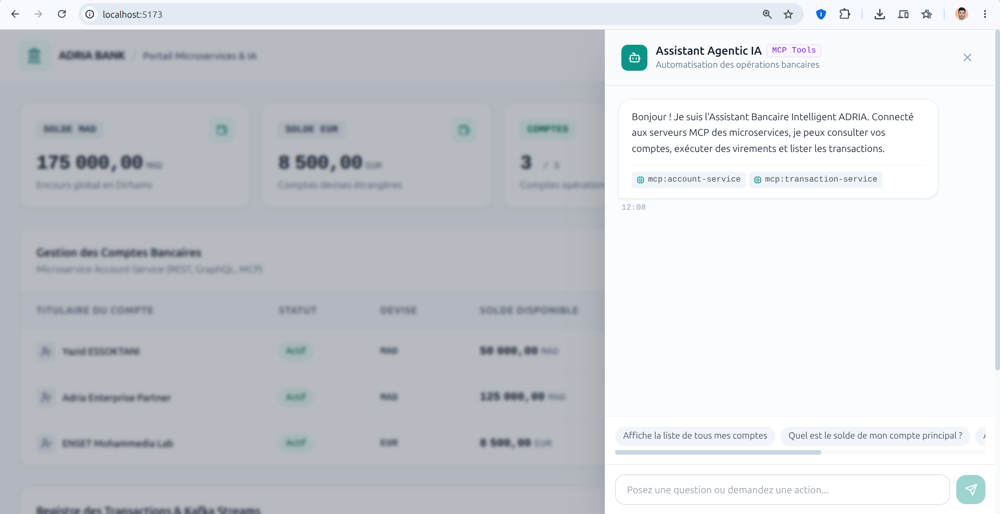
</div>

---

## Conclusion de la Recette Technique

> [!IMPORTANT]
> L'ensemble des **14 preuves visuelles d'exécution** atteste du bon fonctionnement et de la conformité intégrale des composants de la plateforme **ADRIA Bank** :
> - **Architecture Multi-services :** Découverte Eureka, Configuration Cloud centralisée, Passerelle API réactive.
> - **Données & Protocoles :** REST, GraphQL (GraphiQL), Modèles d'outils MCP, Streaming d'événements Kafka.
> - **Robustesse & Résilience :** Circuit Breaker Resilience4J, politiques de plafonnement et réconciliation comptable.
> - **Expérience Utilisateur :** Interface Web Bento Grid Clean Light UI et assistant agentic conversationnel.

---
[Retour au README Principal](../README.md)
